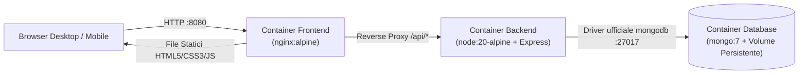

# EvigDog Studio — Web Application Cloud-Native

Progetto per il corso di **Applicazioni Web, Mobile e Cloud – Modulo 2** (A.A. 2025/2026)  
**Università degli Studi di Camerino (UNICAM)** — Corso di Laurea in Informatica per la Comunicazione Digitale (L-31)  
**Docente:** Prof. Christian Lillini

---

## 1. Descrizione del Progetto

**EvigDog Studio** è un'applicazione web **Cloud-Native a 3 livelli** (**Frontend + Backend + Database**), progettata in **Figma** (in versione Desktop e Mobile) e realizzata seguendo i principi di modularità, containerizzazione Docker e disaccoppiamento tramite API REST.

L'applicazione presenta l'ecosistema digitale di uno studio creativo e ingegneristico milanese attraverso **8 pagine complete e responsive**:
1. **Home (`index.html`)**: Value proposition hero, i 6 valori fondanti, anteprima dinamica del Portfolio, panoramica dei Servizi, metodo di lavoro in 5 step e anteprima del Team.
2. **Servizi (`servizi.html`)**: Split hero con contatori, striscia animata (`MarqueeStrip`), elenco dettagliato dei 6 servizi caricati da Database con tag e deliverable, statistiche e processo.
3. **Portfolio (`portfolio.html`)**: Split hero con mosaico, filtro dinamico per categoria (`Tutti`, `Brand Identity`, `UI/UX Design`, `Web Design & Dev`, `Fotografia & Video`), componente `PullQuote`, caso studio in evidenza (*Rebrand Luxe Café*) e recensioni clienti.
4. **Team (`team.html`)**: Hero slider interattivo per sfogliare i 5 membri del team (*Sofia Reale, Marco Torelli, Elena Vitale, Davide Mancini, Luca Ferrari*), directory interattiva e sezione *Come Pensiamo*.
5. **Metodo (`metodo.html`)**: Hero narrativo, le 6 card del processo operativo, approfondimento *Lancio & Oltre*, **FAQ Accordion** interattivo caricato dal database e Call-To-Action finale.
6. **Contatti (`contatti.html`)**: Hero introduttivo *Parliamo*, recapiti dello studio e **Form di Contatto** reale che valida e salva le richieste nel database (`POST /api/contacts`).
7. **Manutenzione (`manutenzione.html`)**: Schermata di servizio attivabile/disattivabile in tempo reale tramite l'API `/api/status` dalla Dashboard Admin.
8. **Dashboard Admin (`admin.html`)**: Backoffice protetto da codice di accesso (configurabile via `.env`) per monitorare la telemetria del container Backend (`hostname`, `uptime`, `RAM`, stato DB), attivare/disattivare la **Modalità Manutenzione**, e gestire (filtrare, aggiornare stato `nuovo` / `in_lavorazione` / `completato` o eliminare) i messaggi inviati dagli utenti e le iscrizioni email dal Footer.

---

## 2. Architettura Cloud-Native

L'architettura è orchestrata tramite **Docker Compose** (`docker-compose.yaml`) su tre container distinti:



### Scelte Architetturali e Motivazioni Tecniche (per la Discussione Orale)
- **Frontend (`nginx:alpine`)**: Utilizza HTML5 semantico, CSS3 modulare (`variables.css`, `components.css`, `pages.css`) fedele ai token Figma (`DM Sans`, palette `#2F1505` / `#3D1C08` / `#EDCD91` / `#F5ECD7` / `#A8592B`) e JavaScript Vanilla modulare (`api.js`, `components.js`, `pages.js`, `admin.js`). Nginx funge sia da web server ad alte prestazioni per gli asset statici (con compressione Gzip), sia da **Reverse Proxy** inoltrando le chiamate `/api/*` al container `backend`, eliminando problemi di CORS ed esponendo un singolo punto d'ingresso.
- **Backend (`node:20-alpine` + Express)**: Espone API REST stateless strutturate per dominio (`contentRoutes.js`, `contactRoutes.js`, `systemRoutes.js`). Include l'endpoint `/api/health` che restituisce `hostname`, `platform`, `uptime` e memoria del container (utile per verificare il bilanciamento del carico o lo stato dei pod).
- **Database (`mongo:7` + Fallback Resiliente)**: Al primo avvio il backend esegue automaticamente il **seed** delle collezioni (`projects`, `services`, `team`, `faqs`, `contacts`, `newsletter`, `settings`) utilizzando un volume Docker persistente (`mongo_data`). Se avviato fuori da Docker senza un'istanza MongoDB attiva, il livello database (`src/config/db.js`) attiva automaticamente un **fallback trasparente su file JSON locale**, garantendo portabilità immediata su qualsiasi macchina.

---

## 3. Guida Rapida di Avvio

### Opzione A — Avvio con Docker Compose (Consigliato)
Assicurarsi di avere **Docker** e **Docker Compose** installati:

```bash
cp .env.example .env
docker compose up --build -d
```

- **Sito Web (Frontend Nginx + Reverse Proxy):** [http://localhost:8080](http://localhost:8080)
- **Dashboard Admin:** [http://localhost:8080/admin.html](http://localhost:8080/admin.html) (Codice predefinito in `.env`: `evigdog-admin-2026`)
- **API Backend diretta / Healthcheck:** [http://localhost:3000/api/health](http://localhost:3000/api/health)

Per fermare i container:
```bash
docker compose down
```

### Opzione B — Avvio Locale Rapido (Senza Docker)
Il server Express serve automaticamente anche la cartella `frontend/` e utilizza lo store persistente locale se MongoDB non è attivo:

```bash
cd backend
npm install
npm start
```

- Aprire nel browser: [http://localhost:3000](http://localhost:3000)
- Dashboard Admin: [http://localhost:3000/admin.html](http://localhost:3000/admin.html)

---

## 4. Esecuzione dei Test Automatici

Il backend include una suite di test automatici (`backend/tests/api.test.js`) basata sul test runner nativo di Node.js (`node:test`):

```bash
cd backend
npm test
```

Inoltre, nella cartella `bruno_collection/` è disponibile la collezione **Bruno** pronta da importare per testare interattivamente tutti gli endpoint REST (come visto a lezione).

---

## 5. Riepilogo Endpoint REST API

| Metodo | Endpoint | Autenticazione | Descrizione |
| :--- | :--- | :--- | :--- |
| `GET` | `/api/health` | Pubblico | Stato del container, memoria, uptime, hostname e connessione DB |
| `GET` | `/api/status` | Pubblico | Stato corrente della modalità manutenzione (`maintenanceMode`) |
| `POST` | `/api/status` | Header `x-admin-code` | Attiva/disattiva in tempo reale la modalità manutenzione |
| `GET` | `/api/projects` | Pubblico | Lista progetti Portfolio (supporta filtro `?category=...`) |
| `GET` | `/api/services` | Pubblico | Lista dei 6 servizi dello studio con deliverable |
| `GET` | `/api/team` | Pubblico | Lista dei 5 membri del team per lo slider e la tabella |
| `GET` | `/api/faqs` | Pubblico | Lista delle domande frequenti (FAQ) |
| `POST` | `/api/contacts` | Pubblico | Salva un nuovo messaggio inviato dal Form di Contatto |
| `GET` | `/api/contacts` | Header `x-admin-code` | Elenca i messaggi ricevuti (supporta filtro `?status=...`) |
| `PATCH` | `/api/contacts/:id` | Header `x-admin-code` | Aggiorna lo stato (`nuovo`, `in_lavorazione`, `completato`) |
| `DELETE` | `/api/contacts/:id` | Header `x-admin-code` | Elimina un messaggio dal database |
| `POST` | `/api/newsletter` | Pubblico | Registra una nuova email inviata dal form nel Footer |
| `GET` | `/api/newsletter` | Header `x-admin-code` | Elenca tutte le email registrate dal Footer |
| `DELETE` | `/api/newsletter/:id` | Header `x-admin-code` | Rimuove un'email registrata |

